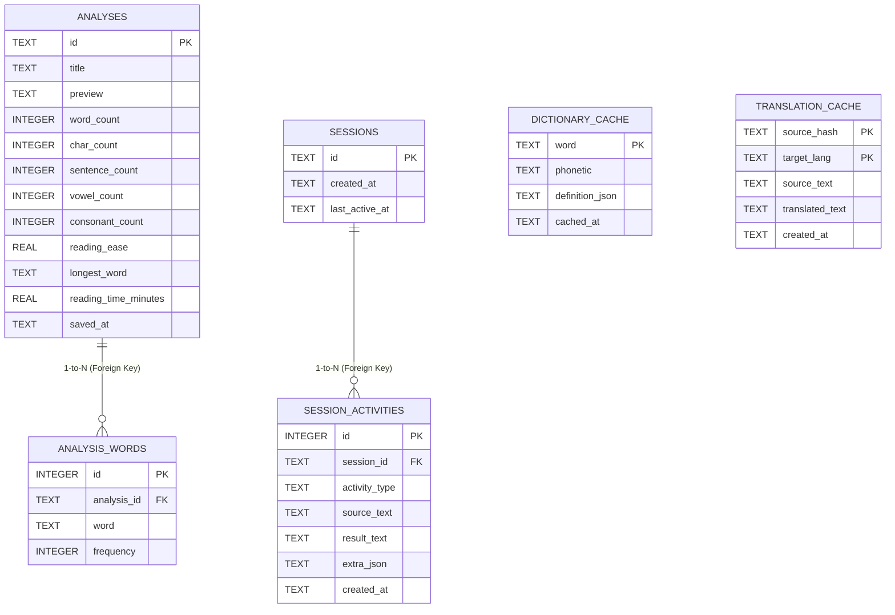

# SQL Database & JDBC Architecture Guide
**Course Code:** PBCST304 — Object Oriented Programming (KTU S3 Syllabus)  
**Project:** LexiCore Word Counter & Text Analyzer  
**Storage Engine:** Embedded SQLite Database via Java JDBC Connectivity  

---

## 1. Overview of the SQL JDBC Setup

The project uses a **100% proper, robust, and zero-configuration SQL database setup** built directly on top of the standard Java Database Connectivity (JDBC) API. 

All database records are stored physically on your laptop inside the project's [`data/`](file:///Users/johnszachariah/Downloads/TextAnalyzer-main/data/) directory. There is **no need for any external database daemon (like MySQL or PostgreSQL server)** to be running or installed, meaning the project is completely portable, reliable, and will never fail during an offline evaluation or viva presentation.

### Key Architectural Highlights
- **Singleton Pattern:** Managed by [`DatabaseManager.java`](file:///Users/johnszachariah/Downloads/TextAnalyzer-main/src/com/textanalyzer/storage/DatabaseManager.java) with thread-safe double-checked locking.
- **Relational 1-to-N Schema:** Parent table `analyses` linked to child table `analysis_words` via `FOREIGN KEY (analysis_id) REFERENCES analyses(id) ON DELETE CASCADE`.
- **ACID Transactions:** Manual transaction demarcation (`conn.setAutoCommit(false); conn.commit(); conn.rollback();`) ensuring all-or-nothing atomicity.
- **PreparedStatement Batch Processing:** Top word frequencies are saved in batches (`ps.addBatch()` and `ps.executeBatch()`) to demonstrate high-performance JDBC techniques.
- **SQL Injection Prevention:** 100% parameterized queries via `PreparedStatement`.
- **Introspection:** Full extraction of metadata using `java.sql.DatabaseMetaData` and `java.sql.ResultSetMetaData`.
- **External Configuration:** Database parameters externalized in [`data/database.properties`](file:///Users/johnszachariah/Downloads/TextAnalyzer-main/data/database.properties).

---

## 2. Physical File Locations on Your Laptop

All database files and exports reside directly on your laptop disk in [`data/`](file:///Users/johnszachariah/Downloads/TextAnalyzer-main/data/):

| File / Directory | Description | How to Show to Staff |
| :--- | :--- | :--- |
| **`data/textanalyzer.db`** | **The physical SQLite Database file**. Stores all tables, indexes, and records. | Open in Finder (`open data`), check file size in terminal (`ls -lh data/textanalyzer.db`), or open in *DB Browser for SQLite*. |
| **`data/database.properties`** | **JDBC Configuration file**. Configures driver, URL, and pragmas. | Open in VS Code, TextEdit, or any text editor. |
| **`data/textanalyzer_dump.sql`** | **Standard SQL Dump Export**. Contains standard SQL `CREATE TABLE` and `INSERT INTO` statements. | Open in VS Code/Notepad to show the raw SQL script. Can be imported into MySQL, PostgreSQL, or SQLite. |
| **`data/exports/*.csv`** | **CSV exports of every table** (`analyses.csv`, `analysis_words.csv`, `sessions.csv`, `session_activities.csv`, `dictionary_cache.csv`, `translation_cache.csv`). | Double-click to open directly in **Microsoft Excel**, Numbers, or Google Sheets. |
| **`data/reports/`** | Exported text (`.txt`) and JSON (`.json`) analysis reports. | Text files formatted with full analysis metrics. |
| **`data/backups/`** | Physical `.db` backup snapshots created on demand. | Point-in-time binary copies of the database file. |

---

## 3. Database Schema Design (6 Relational Tables)



---

## 4. How to Show the Setup to Project Analysing Staff

You can showcase the database setup using **4 different presentation methods**:

### Method 1: Interactive Web UI (SQL Database & JDBC Studio)
1. Run `./run-web.sh` (or choose Option 1 in `./run.sh`).
2. Open your browser at `http://localhost:8080`.
3. Click the **"🗄️ SQL Database & JDBC"** tab.
4. What to demonstrate to the staff:
   - **Database Status Card:** Point out `ONLINE`, the absolute path on your laptop (`/Users/.../data/textanalyzer.db`), file size in KB, and the active `org.sqlite.JDBC` driver.
   - **Table Explorer:** Click through `analyses`, `analysis_words`, `sessions`, `session_activities`, and show the schema (columns, types, Primary Key 🔑) alongside live table rows.
   - **Live SQL Query Console:** Click one of the pre-set query buttons (e.g., `2. Relational JOIN (Analyses + Words)`) or let the staff type any `SELECT` query, then click **"Execute SQL Query"**. It runs live and shows execution time in milliseconds (e.g. `⏱ Executed in 0.8 ms`).
   - **One-Click File Exports:**
     - Click **"Download SQL Dump (.sql)"** to show the generated `.sql` file.
     - Click **"Export All Tables to CSV"** to generate spreadsheets in `data/exports/`.

---

### Method 2: Terminal Console Mode (CLI)
1. Run `./run-console.sh` (or choose Option 2 in `./run.sh`).
2. From the main menu, select **Option 9: `SQL Database & JDBC Studio`**.
3. Choose from the interactive sub-menu:
   - **`1`** View JDBC Metadata & Storage File Info.
   - **`2`** View Table Schemas (`DatabaseMetaData`).
   - **`3`** Browse Saved Analyses & Word Frequencies (runs a relational SQL `JOIN` query).
   - **`5`** Interactive SQL Query Runner: Type any SQL query right in the terminal!
   - **`6`** Export Database to `data/textanalyzer_dump.sql`.
   - **`7`** Export All Tables to `data/exports/*.csv`.
   - **`8`** Seed Demo Records (demonstrates ACID commit).

---

### Method 3: One-Click Automated Verification Script
If the analyzing staff asks: *"Can you prove that your JDBC driver, connections, transactions, and foreign keys actually work?"*
Simply run in the terminal:
```bash
./verify-db.sh
```
*(Or run `./run.sh` and select Option 4)*

This script automatically executes 9 comprehensive JDBC tests:
```text
================================================================
   LEXICORE SQL DATABASE & JDBC AUTOMATED VERIFICATION SUITE   
   Course: PBCST304 Object Oriented Programming (KTU S3)       
================================================================
   [PASS] 1. SQLite JDBC Driver (org.sqlite.JDBC) loaded successfully
   [PASS] 2. Active JDBC connection verified to local file: data/textanalyzer.db
   [PASS] 3. All 6 relational tables verified with valid schemas
   [PASS] 4. ACID Transaction Commit + Batch Insert verified (Parent & Child persisted)
   [PASS] 5. ACID Transaction Rollback verified (Uncommitted changes cleanly undone)
   [PASS] 6. Relational SQL JOIN query executed successfully
   [PASS] 7. DatabaseMetaData inspected (SQLite v3.45.1, Driver: SQLite JDBC, Transactions: true)
   [PASS] 8. SQL Dump file generated on laptop disk: data/textanalyzer_dump.sql
   [PASS] 9. CSV export generated 6 table files in data/exports/
================================================================
   VERIFICATION RESULTS: 9 / 9 TESTS PASSED (100%)
================================================================
```

---

### Method 4: Showing the Physical Files in Finder / Excel
In macOS Terminal, type:
```bash
open data
open data/exports
```
This opens the folders in Finder. You can open:
1. `data/textanalyzer_dump.sql` in VS Code or TextEdit to show standard SQL.
2. `data/exports/analyses.csv` in Microsoft Excel to show structured data rows.
3. `data/database.properties` to show enterprise configuration management.

---

## 5. Viva / Evaluation Q&A Cheat Sheet

### Q1: What database engine and JDBC driver does the project use?
> **Answer:** "The application uses **SQLite** through the official **`org.sqlite.JDBC`** driver. SQLite is a serverless, zero-configuration, embedded relational database engine. All data is persisted into a physical file on the laptop disk at `data/textanalyzer.db`. Connection URL is `jdbc:sqlite:data/textanalyzer.db`."

### Q2: Why choose SQLite instead of MySQL or PostgreSQL?
> **Answer:** "For a standalone Java desktop/web application, SQLite is the industry standard (used by Android, iOS, Chrome, Firefox). It stores the entire database in a single self-contained file on the laptop disk. It requires no network port, no background server daemon, and no login credentials that could fail during an offline evaluation, while providing full SQL-92 compliance, ACID transaction guarantees, and JDBC support."

### Q3: What is the difference between `Statement` and `PreparedStatement`?
> **Answer:** 
> - A **`Statement`** compiles and executes raw SQL strings directly, making it vulnerable to SQL injection if user input is concatenated.
> - A **`PreparedStatement`** pre-compiles the SQL template once and accepts parameterized inputs (`ps.setString(1, val)`). It completely eliminates SQL injection vulnerabilities and offers higher performance when executed repeatedly in batches. We use `PreparedStatement` across all insert, update, and delete operations.

### Q4: How are ACID transaction properties implemented in the project?
> **Answer:** "In [`JdbcStorageService.java`](file:///Users/johnszachariah/Downloads/TextAnalyzer-main/src/com/textanalyzer/storage/JdbcStorageService.java), auto-commit is disabled via `conn.setAutoCommit(false)`. The parent analysis record is inserted into `analyses`, and its associated top word frequencies are batch-inserted into `analysis_words`. If both succeed, `conn.commit()` is called. If any `SQLException` occurs, `conn.rollback()` is invoked in the catch block to cleanly undo all changes, ensuring complete Atomicity and Consistency."

### Q5: How is a 1-to-N (One-to-Many) relationship demonstrated?
> **Answer:** "The `analyses` table is the parent table (One). Each analysis has multiple top word frequencies stored in `analysis_words` (Many). The child table has a foreign key constraint:  
> `FOREIGN KEY(analysis_id) REFERENCES analyses(id) ON DELETE CASCADE`.  
> When an analysis is deleted, its child word frequency rows are automatically cleaned up, and we can query both tables simultaneously using an SQL `INNER JOIN`."

### Q6: What is the difference between `DatabaseMetaData` and `ResultSetMetaData`?
> **Answer:** 
> - **`DatabaseMetaData`** provides comprehensive information about the database product itself (e.g., product name, product version, driver name, driver version, supported SQL features, and catalog of tables).
> - **`ResultSetMetaData`** provides column-level information about the specific rows returned by a query (e.g., column count, column names/labels, data types, and display sizes). Both are utilized in our interactive SQL console."

---

## 6. Project File Structure (Database Related)

```text
TextAnalyzer-main/
├── lib/
│   └── sqlite-jdbc.jar              # SQLite JDBC Driver (v3.45.1)
├── data/
│   ├── textanalyzer.db              # Physical SQLite Database file on laptop
│   ├── database.properties          # Externalized JDBC configuration properties
│   ├── textanalyzer_dump.sql        # Exported standard SQL dump file (DDL + DML)
│   ├── exports/                     # Exported CSV spreadsheets
│   │   ├── analyses.csv
│   │   ├── analysis_words.csv
│   │   ├── sessions.csv
│   │   ├── session_activities.csv
│   │   ├── dictionary_cache.csv
│   │   └── translation_cache.csv
│   ├── backups/                     # Binary database backup files (.db)
│   ├── reports/                     # Plain text and JSON reports
│   └── sample.txt                   # Sample test document
├── src/com/textanalyzer/
│   ├── storage/
│   │   ├── DatabaseManager.java     # Singleton JDBC Manager & Connection handler
│   │   ├── JdbcStorageService.java  # JDBC implementation with ACID transactions
│   │   ├── FileStorageService.java  # Fallback storage service
│   │   └── StorageService.java      # Interface defining persistence contracts
│   ├── server/handlers/
│   │   └── DatabaseHandler.java     # REST API Handler for SQL Studio & file downloads
│   ├── cli/
│   │   └── TextAnalyzerConsoleApp.java # Terminal CLI with SQL Studio sub-menu
│   └── test/
│       └── DatabaseVerificationTest.java # Automated JDBC verification test suite
├── verify-db.sh                     # One-click shell script to verify SQL/JDBC setup
├── run.sh                           # Launcher with Verification Suite option
├── run-web.sh                       # Web launcher
├── run-console.sh                   # CLI launcher
└── build.sh                         # Compiles all Java sources with JDK 21
```
