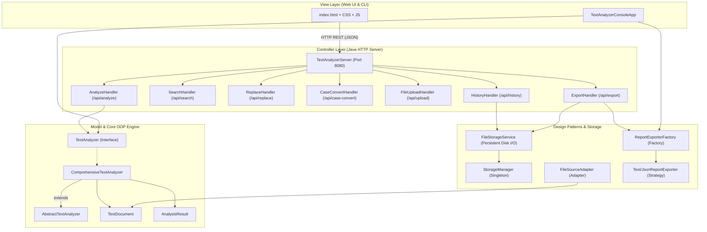

# Word Counter & Text Analyzer Web Application

A full-stack, Object-Oriented Text Analysis and Word Counting application built with a **Java backend (JDK 21 LTS)**, a **modern HTML5/CSS3/JavaScript frontend**, and a **RESTful HTTP Controller layer** that connects them.

This application strictly adheres to the **KTU PBCST304 Object Oriented Programming syllabus** (Modules 1–4, SOLID principles, design patterns) and fulfills 100% of the functional requirements outlined in the **Word Counter & Text Analyzer Report Specification**.

---

## 🌟 Key Features

1. **Comprehensive Text Metrics:**
   - **Word Count:** Total words tokenized with whitespace and punctuation rules.
   - **Character Count:** Total characters with spaces, characters without spaces, letters, digits, and special characters.
   - **Sentence Count:** Sentence boundary parsing analyzing `.`, `?`, and `!`.
   - **Paragraph Count:** Multi-line paragraph parsing.
   - **Vowel & Consonant Breakdown:** Character-by-character analysis with individual distribution for `A`, `E`, `I`, `O`, `U` and ratio calculation.
   - **Longest & Shortest Words:** Identifies extreme character lengths and all matching words.
   - **Word Frequency Analysis:** Visual frequency bar chart and searchable frequency table sorted descending.
   - **Readability & Timing:** Flesch Reading Ease score, grade-level description, and estimated reading time.

2. **Editing & Text Manipulation:**
   - **Word & Phrase Search:** Query matching with options for Case-Sensitivity and Whole-Word matching, showing total occurrences and contextual line snippets.
   - **Find & Replace:** Target replacement with live preview and "Apply to Main Editor" action.
   - **Case Conversion:** Instant conversion to **UPPERCASE**, **lowercase**, **Title Case**, or **Sentence case**.

3. **File I/O, SQL Database & JDBC Persistence (Module 4):**
   - **Embedded SQLite Database via JDBC:** Physical file storage on laptop at `data/textanalyzer.db` with zero external server dependencies.
   - **Relational 1-to-N Schema with Foreign Keys:** `analyses` parent table and `analysis_words` child table linked via `FOREIGN KEY ... ON DELETE CASCADE`.
   - **ACID Transactions:** Manual transaction demarcation (`commit` / `rollback`) and PreparedStatement batch updates.
   - **Live SQL Database Studio:** Web UI tab & CLI Option 9 with schema inspector, table data browser, and live interactive SQL query console.
   - **Laptop File Exports:** Generates standard SQL dump (`data/textanalyzer_dump.sql`) and CSV spreadsheets (`data/exports/*.csv`).
   - **External Configuration:** JDBC settings externalized in `data/database.properties`.
   - **File Upload & Drag-and-Drop:** Accepts `.txt`, `.md`, `.csv`, `.log`, and `.json` files.
   - **Report Exporters:** Generates and exports downloadable reports in **Plain Text (.txt)** or **JSON (.json)** formats via the **Strategy Pattern**.

4. **Dual Running Modes:**
   - 🌐 **Web Application Mode:** Modern, responsive browser interface with Dark/Light themes.
   - 💻 **Menu-Driven Console Mode:** Full CLI menu (Options 1–10) fulfilling Section 1.2 of the Report Specification for terminal testing and evaluation.

---

## 🏛 Architecture: Model-View-Controller (MVC)



---

## 🚀 How to Run

### Option 1: Quick Launch Script (Recommended)
Open your terminal in the project directory and execute:
```bash
./run.sh
```
This script will prompt you to choose between:
- **1:** Launch Web Application (Default - includes SQL Studio)
- **2:** Launch Menu-Driven Console Application (CLI with DB Manager)
- **3:** Compile Sources
- **4:** Run SQL Database & JDBC Verification Suite (Staff Evaluation)
- **5:** Exit

---

### Option 2: Run SQL Database & JDBC Verification Suite (Staff Demo)
To immediately verify and demonstrate the SQL JDBC setup to staff in 3 seconds:
```bash
./verify-db.sh
```
*(Runs 9 automated tests verifying JDBC drivers, physical file storage on laptop, foreign keys, ACID transactions, relational JOINs, SQL dump generation, and CSV exports)*

---

### Option 3: Directly Launch the Web Application
```bash
./run-web.sh
```
Then open your web browser at:
👉 **[http://localhost:8080](http://localhost:8080)** (navigate to the **"🗄️ SQL Database & JDBC"** tab to inspect the database, run queries, and download exports).

---

### Option 4: Directly Launch the Console Application
```bash
./run-console.sh
```
Select **Option 9** from the menu to open the interactive SQL Database Manager in the terminal.

---

### Option 4: Manual Build and Run using Java 21
To compile manually:
```bash
/Library/Java/JavaVirtualMachines/temurin-21.jdk/Contents/Home/bin/javac -d bin $(find src -name "*.java")
```
To run the Web App:
```bash
/Library/Java/JavaVirtualMachines/temurin-21.jdk/Contents/Home/bin/java -cp bin com.textanalyzer.Main
```
To run the Console App:
```bash
/Library/Java/JavaVirtualMachines/temurin-21.jdk/Contents/Home/bin/java -cp bin com.textanalyzer.Main --cli
```
To run the Automated Test Suite (26 automated test cases):
```bash
/Library/Java/JavaVirtualMachines/temurin-21.jdk/Contents/Home/bin/java -cp bin com.textanalyzer.test.TextAnalyzerTest
```

---

## 📚 OOP Concepts & Syllabus Compliance Summary

For full details, see [`OOP_MAPPING.md`](file:///Users/johnszachariah/Documents/Text%20Analyzer/OOP_MAPPING.md).

- **Encapsulation:** Private fields, immutable objects (`TextDocument`, `AnalysisResult`), public getter APIs.
- **Inheritance:** `ComprehensiveTextAnalyzer` extends `AbstractTextAnalyzer` with constructor chaining (`super(...)`).
- **Polymorphism:**
  - *Method Overloading:* `analyze(String text)`, `analyze(TextDocument doc)`, `search(...)`.
  - *Dynamic Method Dispatch:* Runtime resolution of `TextAnalyzer` and `ReportExporter` interface contracts.
- **Abstract Classes vs. Interfaces:**
  - `TextAnalyzer`, `Searchable`, `Transformable`, `StorageService` (Interfaces).
  - `AbstractTextAnalyzer` (Abstract base with shared template state).
- **Exception Handling:**
  - Custom checked exceptions: `TextAnalysisException`, `StorageException`.
  - Custom unchecked exception: `InvalidInputException`.
  - Robust `try-with-resources` ensuring streams and files are closed safely.
- **Design Patterns (Module 3):**
  - **Singleton Pattern:** `StorageManager` (thread-safe, lazy initialized).
  - **Adapter Pattern:** `FileSourceAdapter` (adapts file paths to `DocumentSource`).
  - **Strategy & Factory Patterns:** `ReportExporterFactory` dynamically producing `TextReportExporter` or `JsonReportExporter`.
- **SOLID Principles (Module 4):** Single Responsibility, Open/Closed, Liskov Substitution, Interface Segregation, and Dependency Inversion.

---

## 📂 Project Structure

```
Text Analyzer/
├── PBCST304_Object_Oriented_Programming.pdf  # KTU OOP Syllabus
├── Word_Counter_and_Text_Analyzer.pdf        # Report Specification
├── README.md                                 # Project Overview & Guide
├── OOP_MAPPING.md                            # Complete syllabus compliance map
├── build.sh                                  # Build script
├── run.sh                                    # Master runner script
├── run-web.sh                                # Direct Web launcher
├── run-console.sh                            # Direct Console launcher
├── data/
│   ├── sample.txt                            # Sample input file
│   ├── history.json                          # Persistent storage for saved analyses
│   └── reports/                              # Directory containing exported reports
├── web/
│   ├── index.html                            # Frontend HTML interface
│   ├── style.css                             # Dark & Light responsive styling
│   └── app.js                                # Frontend Controller & REST client
└── src/
    └── com/
        └── textanalyzer/
            ├── Main.java                     # Application entry point
            ├── model/                        # Domain Models & DTOs
            │   ├── TextDocument.java
            │   ├── AnalysisResult.java
            │   ├── WordFrequency.java
            │   ├── SearchResult.java
            │   ├── CaseType.java
            │   └── HistoryRecord.java
            ├── core/                         # Core OOP Interfaces & Analyzers
            │   ├── TextAnalyzer.java
            │   ├── Searchable.java
            │   ├── Transformable.java
            │   ├── AbstractTextAnalyzer.java
            │   └── ComprehensiveTextAnalyzer.java
            ├── pattern/                      # Design Patterns (Singleton, Adapter, Factory, Strategy)
            │   ├── StorageManager.java
            │   ├── DocumentSource.java
            │   ├── FileSourceAdapter.java
            │   ├── ReportExporter.java
            │   ├── TextReportExporter.java
            │   ├── JsonReportExporter.java
            │   └── ReportExporterFactory.java
            ├── storage/                      # Persistence Layer (File I/O)
            │   ├── StorageService.java
            │   └── FileStorageService.java
            ├── exception/                    # Custom Checked & Unchecked Exceptions
            │   ├── TextAnalysisException.java
            │   ├── StorageException.java
            │   └── InvalidInputException.java
            ├── util/                         # Utilities (Pure JSON & Text algorithms)
            │   ├── TextUtils.java
            │   └── JsonUtil.java
            ├── server/                       # HTTP Server & REST API Controller
            │   ├── TextAnalyzerServer.java
            │   ├── ApiResponse.java
            │   └── handlers/
            │       ├── StaticFileHandler.java
            │       ├── BaseApiHandler.java
            │       ├── AnalyzeHandler.java
            │       ├── SearchHandler.java
            │       ├── ReplaceHandler.java
            │       ├── CaseConvertHandler.java
            │       ├── FileUploadHandler.java
            │       ├── HistoryHandler.java
            │       └── ExportHandler.java
            ├── cli/                          # Menu-Driven Console Application
            │   └── TextAnalyzerConsoleApp.java
            └── test/                         # Test Suite
                ├── TextAnalyzerTest.java
                └── ServerIntegrationTest.java
```
